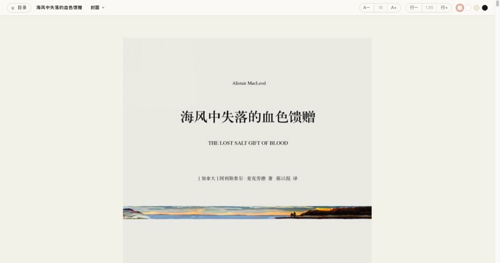
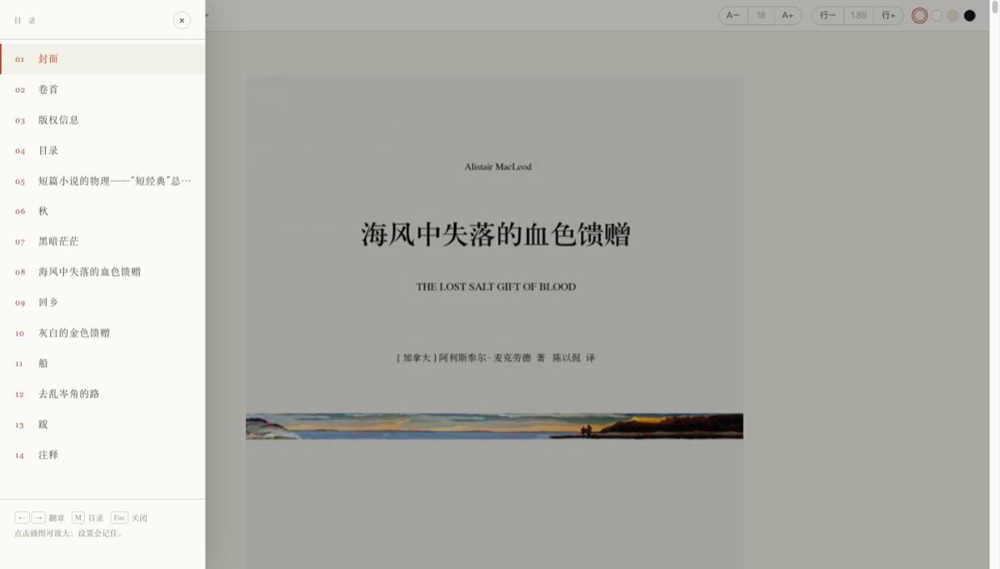

# magazine-html

把一本 EPUB 转成**单文件、可离线打开**的杂志风格 HTML 阅读器：双击就能在浏览器里读，不联网、不依赖外链、不需要起服务器。

这是一个跨 harness 的 **Agent Skill**（agents.md 规范），附带两个确定性脚本：转换器 + 验收器。



---

## 它解决什么

EPUB 在 PC 上读通常得装专门的阅读器，或者在 Kindle 上被 KPF 重排掉所有版式设计。
把书转成单文件 HTML 之后：

- **双击即开**，任何现代浏览器都能看，Mac / Windows / Linux 通吃
- **完全离线**：图片转成 data URI 内嵌，html 文件拎到哪都能显示
- **版式完全可控**：字体、行距、主题、版心都能在工具栏里实时调
- **仍然是一本书**：目录抽屉、章节跳转、进度条、插图放大、打印样式都保留

```bash
python3 scripts/epub_to_html.py book.epub -o book.html
python3 scripts/verify_html.py book.html
```

---

## 产出长什么样

**工具栏** —— 目录按钮 / 当前章节 / 字号 / 行距 / 主题色板



**目录抽屉** —— 封面、卷首、版权信息、目录、总序、每篇短篇、跋、注释，带序号与快捷键提示


**正文** —— 沿用书里的杂志样式：章号、中英章名、插画与图注、首行缩进两端对齐


---

## 安装

仓库里的 skill 放在 `skills/magazine-html/`（目录名与 skill 名一致），拷到任意 harness 的 skills 根目录即可：

```bash
git clone https://github.com/a998151/magazine-html.git
cp -R magazine-html/skills/magazine-html ~/.agents/skills/
```

其他 harness（`~/.codex/skills`、`~/.claude/skills` 等）同理，换根目录就行。

---

## 用法

### 方式一：交给 agent（推荐）

说需求即可，触发词例如：

- 「把 `某书.epub` 转成 html 看」
- 「给这本书做个网页版阅读器」
- 「html 观感更好，转成 html 吧」

agent 会自动走：转换 → **跑验收** → 交付。

### 方式二：手动跑

```bash
cd skills/magazine-html

# 转换
python3 scripts/epub_to_html.py book.epub -o book.html

# 只要纯正文、不要阅读器外壳
python3 scripts/epub_to_html.py book.epub -o body.html --no-shell

# 追加自定义样式
python3 scripts/epub_to_html.py book.epub -o book.html --css my.css

# 验收（自动点按钮、查溢出、查 JS 报错）
python3 scripts/verify_html.py book.html
```

**依赖**：Python 3（标准库即可）。验收脚本需要一个 Chrome / Chromium / Edge
（自动探测，或用 `--chrome` / `CHROME_PATH` 指定）。

---

## 验收器做什么

`verify_html.py` 不是摆设，它分两层：

**静态检查**（不需要浏览器）
- 页面上每个 `data-act` 是否都有对应的 JS 处理分支 —— 这是"漏绑一个 id 就废掉后面全部"的安全网
- 样式表/正文里有没有没内嵌的 `url(...)` 外部依赖

**运行时检查**（headless Chrome 注入探针，**真的去点每个按钮**再读回状态）

| 检查项 | 含义 |
| --- | --- |
| `errors` | 页面有没有 JS 运行时错误 |
| `fs` / `lh` | 字号、行距按钮是否真的生效 |
| `theme` / `swatch` | 四个主题色板是否都生效、选中态是否正确 |
| `drawerOpen` / `drawerClose` / `curBtn` | 目录抽屉三条打开路径 |
| `toc` | 目录条目数与文档 section 数是否一致 |
| `imgs` | 正文图片是否全部内嵌（`ext=0`） |
| `lamp` | 点插图能否弹出灯箱 |
| `topBtn` | 回到顶部按钮是否浮现 |
| `keyM` | 快捷键 M 能否开关抽屉 |
| `overflow` | 700 / 1024 / 1440 三种宽度下有没有横向滚动条 |

不跑验收就交付，等于把「按钮按了没反应」这种问题留给用户。

```bash
python3 scripts/verify_html.py book.html
# 静态检查：12 个 data-act 全部有处理分支 ✓
#   宽 700px ✓ errors=0 fs=ok lh=ok theme=ok ... overflow=ok
# ✓ 全部通过
```

---

## 与 magazine-epub 配合

它和 [`magazine-epub`](https://github.com/a998151/magazine-epub) 是一条流水线的两段：

```
原始 EPUB ──[magazine-epub]──> 杂志版 EPUB ──[magazine-html]──> 单文件 HTML
             （插画、扉页、抽言、清理）      （阅读器外壳、离线内嵌、验收）
```

先跑 `magazine-epub` 再跑本 skill，得到的 HTML 观感最好；直接转普通 EPUB 也能跑，
只是正文样式会用本 skill 自带的默认杂志样式。

---

## 踩过的坑（都写在 skill 里了）

1. **逐个 `getElementById().onclick=` 会全盘皆输** —— 漏绑一个 id 抛 TypeError，
   后面所有绑定都不执行。改用事件委托（`data-act` + 一个监听器）。
2. **别把 localStorage 当唯一状态源** —— `file://` 下可能被禁用，写入静默失败，
   改完再读还是旧值 → 按钮像坏了。改成内存状态为准、存储只做持久化。
3. **XHTML 里 `&nbsp;` 是未定义实体** —— 会让整篇 XML 解析失败。
4. **多篇合并后 `body` 选择器只对第一篇生效** —— 转换时把 `body` 统一改写成 `.rbody`。
5. **工具栏 flex 不换行会撑出横向滚动条** —— `flex-wrap:wrap` + `min-width:0`。
6. **内嵌图片要跳过 `data:` 开头的值** —— 否则二次替换会把已生成的 data URI 弄坏。

完整清单见 [`skills/magazine-html/references/notes.md`](skills/magazine-html/references/notes.md)。

---

## 目录结构

```
magazine-html/
├── README.md
├── docs/                        演示截图（SVG，内嵌 PNG）
└── skills/
    └── magazine-html/            目录名 = skill 名，可直接 cp 到任意 skills 根目录
        ├── SKILL.md              触发条件 / 流程 / 硬规矩 / 输出契约 / 失败处理
        ├── agents/openai.yaml    跨 harness 展示元信息
        ├── scripts/
        │   ├── epub_to_html.py   转换器
        │   └── verify_html.py    验收器（headless Chrome）
        └── references/
            ├── reader.css        阅读器外壳样式（工具栏/抽屉/灯箱/主题）
            ├── reader.js         阅读器脚本（事件委托 + 状态管理）
            ├── magazine.css      杂志正文样式（源书没带样式表时的兜底）
            └── notes.md          踩坑与扩展笔记
```

---

## License

尚未指定 License。公开发布前请自行添加一个（如 MIT），或在 README 里注明保留所有权利。
